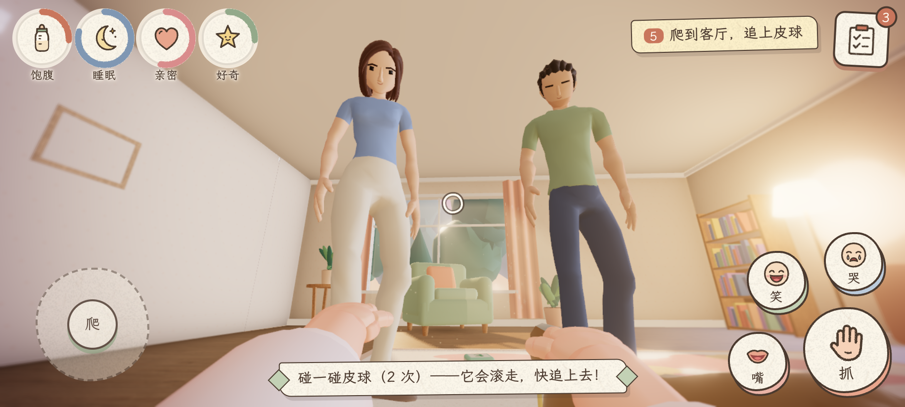
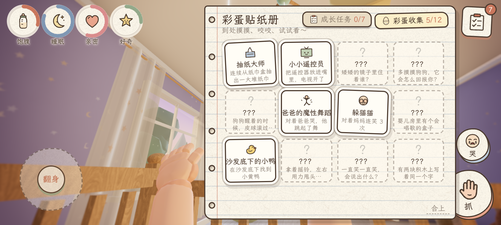
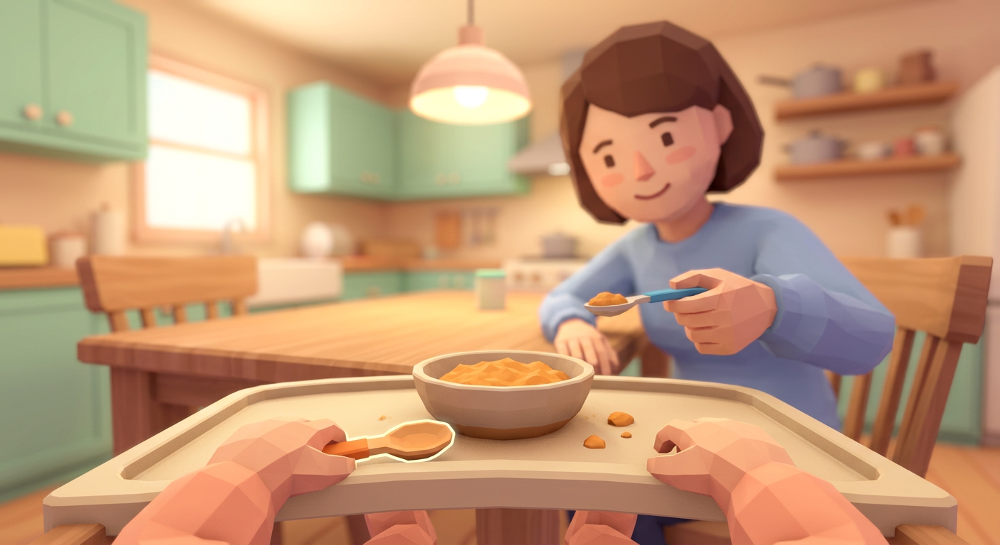

# Life Sim 3D 🍼 → 🎒 → 💼

一款基于 **three.js** 的第一视角 3D 人生模拟游戏：玩家从婴儿开始，亲身经历成长、上学、上班……每个阶段都以第一人称的“亲手交互”推进。

> 当前阶段：**婴儿篇 Demo v3** — 在线试玩：https://game.qigai.tech/ （手机横屏优先，桌面也可玩）

## v3 升级亮点
- **写实光影与材质**：窗口 `RectAreaLight` 天光面光源、高动态真实反射镜（Three.js `Reflector`）、柔和电影级 ACES + Bloom 后处理；自然原木、棉麻、拉丝黄铜、釉面陶瓷与植物叶片等真实室内质感，去除低多边形顶点抖动。
- **更真实的手部、身体与角色**：3 指节解剖结构婴儿小手（真实皮肤微孔法线 + 暖色次表面散射 + 独立透亮指甲盖 + 针织袖口）、低头可见 3D 小身体/踢腿/袜子，靠近镜子可看到会同步笑/哭的实时 3D 倒影；爸爸/妈妈/柴犬增强皮肤纹理、湿润眼角膜高光与毛绒质感。
- **更高自由度与全物品交互**：移除翻身前置任务限制（随时可翻身下床探索）；支持抛投物品（右键 / `Q`）与弹跳物理、爬行轻推小物件、扶着婴儿床/沙发/扶手椅/懒人沙发站立看世界；抽屉、餐边柜门、台灯、落地灯、窗帘（拉合影响采光）、3 频道电视、相框、植物、书籍、枕头、被子、奶嘴、马克杯、花瓶、饼干罐、小木车均可交互，还可直接向爸妈展示手中物品或触发爸爸「举高高」。

## v2 基础能力
- **12 个彩蛋**（记录本里的「彩蛋收集」页）：抽纸大师、小小遥控员、镜子里的宝宝、狗狗的口水、接球好搭档、爸爸的魔性舞蹈、躲猫猫、梦里的星星、沙发底下的小鸭、摇铃派对、第一个词、积木叫妈妈。
- **绘本风 UI**：奶油纸张 + 手绘墨线图标 + 霞鹜文楷字体；蜡笔环形需求表、成长记录本、彩蛋贴纸册、便签提示、绘本封面。
- 素材来源与许可见 [docs/CREDITS.md](docs/CREDITS.md)，所有资源自托管（大陆可访问）。

开发：`npm i && npm run dev`；改了界面文字后运行 `npm run font -- /path/to/LXGWWenKai-Medium.ttf` 重新裁剪字体子集。

- 📄 Demo 策划：[docs/DEMO_PLAN.md](docs/DEMO_PLAN.md)
- 🎨 概念图：[docs/concept/](docs/concept/)

| v2 封面 | v2 婴儿房 |
|---|---|
|  |  |
| **v2 客厅里的爸妈** | **v2 彩蛋贴纸册** |
|  |  |

| 醒来 | 爬行探索 |
|---|---|
|  |  |
| **喂饭互动** | **HUD 草图** |
|  |  |

## 人生阶段路线（长期）

1. 婴儿期（0–2 岁）← Demo
2. 幼儿 / 学前
3. 小学 → 中学（上学、交友、考试）
4. 大学 / 工作（通勤、上班、人际）
5. 成家、中年、老年
