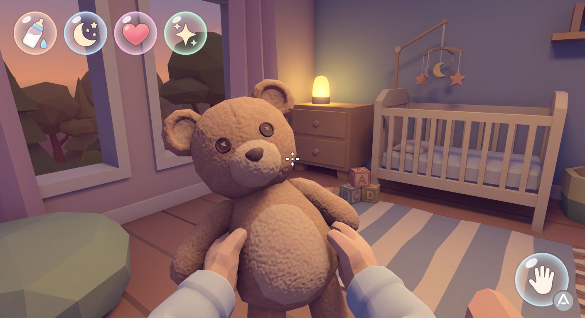

# Life Sim 3D 🍼 → 🎒 → 💼

一款基于 **three.js** 的第一视角 3D 人生模拟游戏：玩家从婴儿开始，亲身经历成长、上学、上班……每个阶段都以第一人称的“亲手交互”推进。

> 当前阶段：**婴儿期 Demo — 策划与概念图**（尚未写代码）

- 📄 Demo 策划：[docs/DEMO_PLAN.md](docs/DEMO_PLAN.md)
- 🎨 概念图：[docs/concept/](docs/concept/)

| 醒来 | 爬行探索 |
|---|---|
|  |  |
| **喂饭互动** | **HUD 草图** |
|  |  |

## 人生阶段路线（长期）

1. 婴儿期（0–2 岁）← Demo
2. 幼儿 / 学前
3. 小学 → 中学（上学、交友、考试）
4. 大学 / 工作（通勤、上班、人际）
5. 成家、中年、老年
