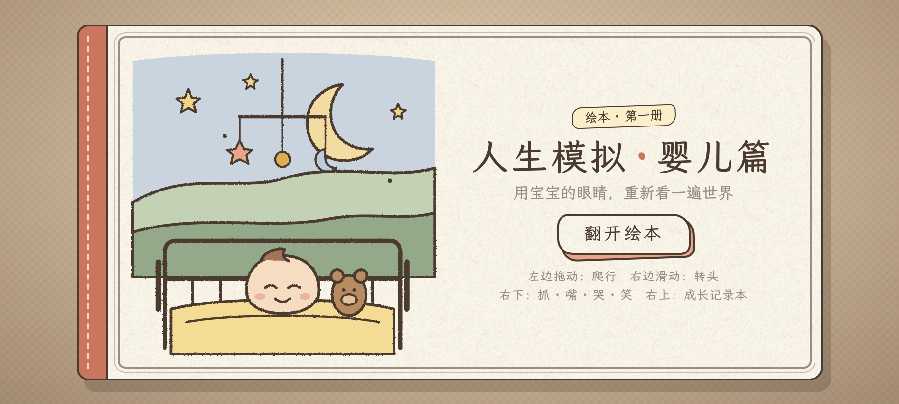
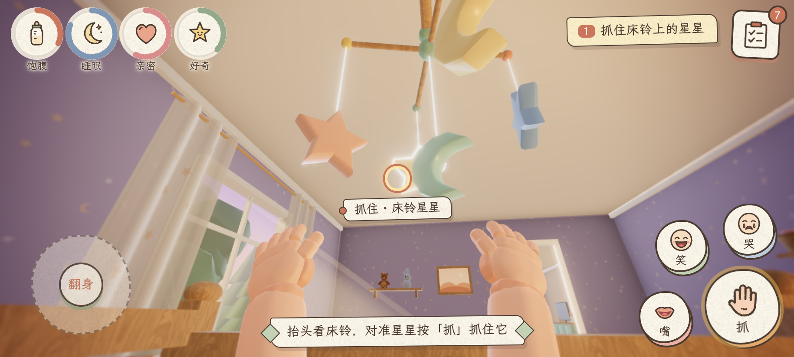
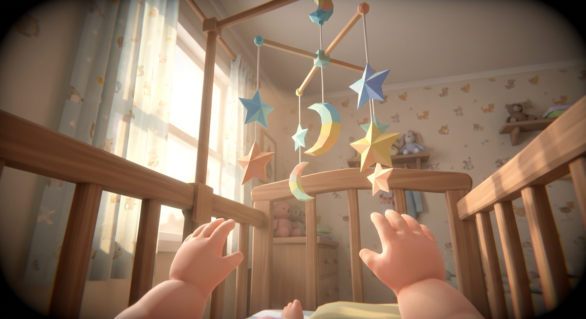
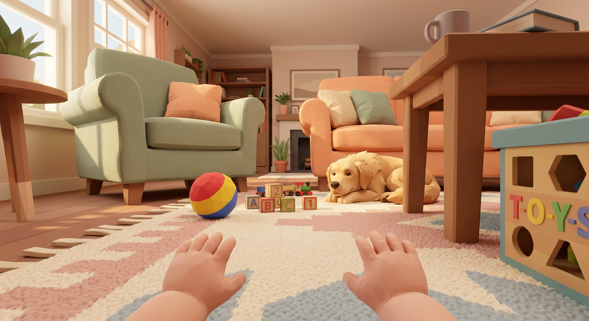

# Life Sim 3D 🍼 → 🎒 → 💼

一款基于 **three.js** 的第一视角 3D 人生模拟游戏：玩家从婴儿开始，亲身经历成长、上学、上班……每个阶段都以第一人称的“亲手交互”推进。

> 当前阶段：**婴儿篇 Demo v2** — 在线试玩：https://game.qigai.tech/ （手机横屏优先，桌面也可玩）

## v2 亮点
- **更真实的光影**：PBR 材质 + ACES 色调映射 + Poly Haven HDRI 环境光；真实木地板/墙面/地毯/绒布/毛绒细节贴图；窗外阳光软阴影、光束与浮尘、接触阴影（桌面端额外 GTAO），光线随游戏从午后慢慢变成黄昏。
- **更真实的角色**：绑骨的妈妈、爸爸、柴犬（CC0 Quaternius），会走路、挥手、跪下、抱宝宝、跳舞、躲猫猫，会眨眼、视线跟着宝宝、会笑；宝宝的小胖手可以连续蜷起手指。
- **绘本风 UI**：奶油纸张 + 手绘墨线图标 + 霞鹜文楷字体；蜡笔环形需求表、成长记录本（完成任务盖「棒」章）、彩蛋贴纸册、便签提示、纸雕按钮、绘本封面。
- **12 个彩蛋**（记录本里的「彩蛋收集」页）：抽纸大师、小小遥控员、镜子里的宝宝、狗狗的口水、接球好搭档、爸爸的魔性舞蹈、躲猫猫、梦里的星星、沙发底下的小鸭、摇铃派对、第一个词、积木叫妈妈。
- 素材来源与许可见 [docs/CREDITS.md](docs/CREDITS.md)，所有资源自托管（大陆可访问）。

开发：`npm i && npm run dev`；改了界面文字后运行 `npm run font -- /path/to/LXGWWenKai-Medium.ttf` 重新裁剪字体子集。

- 📄 Demo 策划：[docs/DEMO_PLAN.md](docs/DEMO_PLAN.md)
- 🎨 概念图：[docs/concept/](docs/concept/)

| v2 封面 | v2 婴儿房 |
|---|---|
|  |  |
| **v2 客厅里的爸妈** | **v2 彩蛋贴纸册** |
|  |  |

| 醒来 | 爬行探索 |
|---|---|
|  |  |
| **喂饭互动** | **HUD 草图** |
|  |  |

## 人生阶段路线（长期）

1. 婴儿期（0–2 岁）← Demo
2. 幼儿 / 学前
3. 小学 → 中学（上学、交友、考试）
4. 大学 / 工作（通勤、上班、人际）
5. 成家、中年、老年
